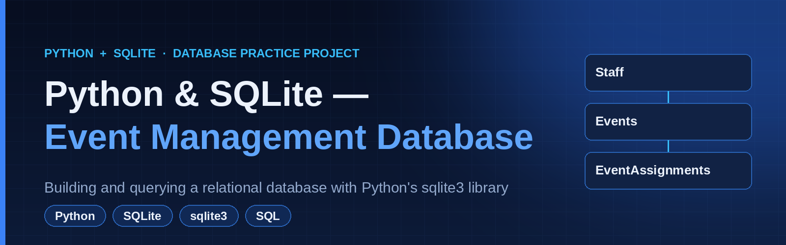
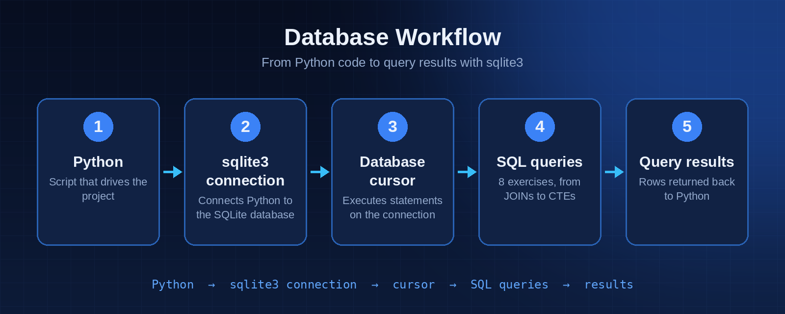
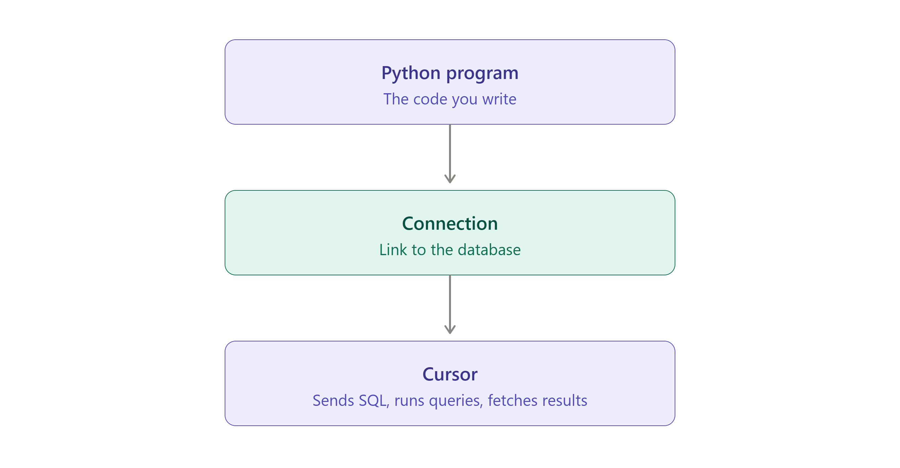
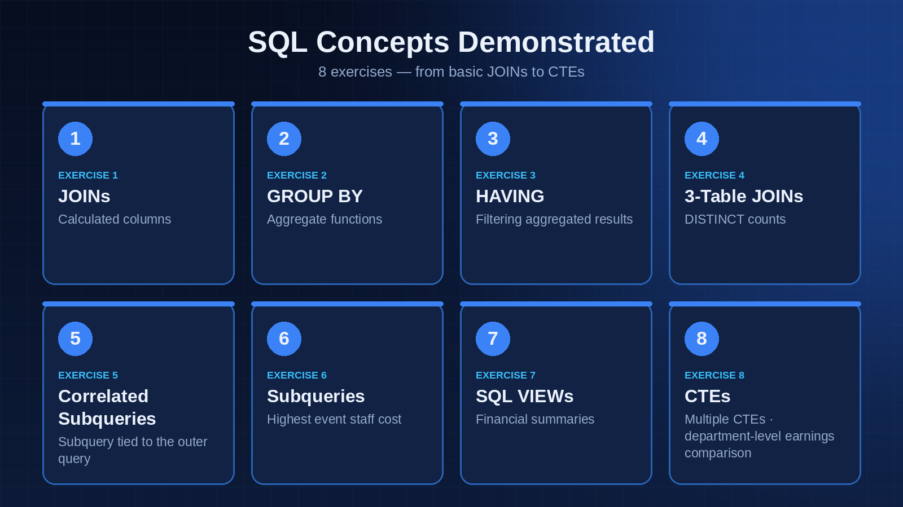

# Event Management Database Practice



A hands-on **Python and SQLite** practice project focused on relational data, SQL querying, and event-cost analysis.

The project models an event-management business using three related tables: staff, events, and event assignments. The notebook creates the tables, inserts sample data, and works through eight SQL exercises.

## Database Structure

| Table | Purpose |
|---|---|
| `Staff` | Staff names, departments, salaries, and hire dates |
| `Events` | Event names, clients, types, budgets, and dates |
| `EventAssignments` | Staff-to-event assignments, roles, hours, and hourly rates |

The `EventAssignments` table connects staff members to events through foreign keys.



## Technologies Used

- **Python** — runs SQL queries through the standard-library `sqlite3` module
- **SQLite** — stores relational data locally
- **SQL** — joins, calculated columns, aggregate functions, subqueries, views, and CTEs
- **Jupyter Notebook** — organizes the exercises

No third-party Python packages are required for the database operations.

## Python–SQLite Connection Workflow

The notebook demonstrates how Python connects to a SQLite database and executes SQL statements using a database connection and cursor.



The basic workflow includes:

1. Importing the `sqlite3` module.
2. Connecting to the database using `sqlite3.connect()`.
3. Creating a cursor using `connection.cursor()`.
4. Executing SQL statements with `cursor.execute()`.
5. Retrieving query results using `cursor.fetchall()`.

## SQL Concepts Practiced



The notebook covers these concepts through practical exercises:

- **Table Creation:** creating relational tables with primary keys, foreign keys, and constraints.
- **Data Insertion:** adding sample staff, event, and assignment records.
- **JOIN Operations:** combining related data across multiple tables.
- **Calculated Columns:** calculating assignment payments from hours worked and hourly rate.
- **Aggregate Functions:** using `COUNT()`, `SUM()`, and `AVG()`.
- **GROUP BY and HAVING:** grouping records and filtering aggregated results.
- **DISTINCT:** counting unique staff members and events.
- **Correlated Subqueries:** comparing an assignment's hourly rate with the average rate for its event.
- **Nested Aggregation:** identifying events with the highest total staff costs.
- **Views:** creating an `EventFinancialSummary` view to analyze event budgets and remaining balances.
- **Common Table Expressions (CTEs):** analyzing staff workloads.
- **Multiple CTEs:** comparing staff earnings with their department's average.

## Key Query Exercises

The notebook contains eight main SQL exercises:

1. **Assignment Payment Analysis** — join staff, events, and assignments, calculate total payments, and sort assignments by payment.
2. **Event Staff Cost Analysis** — calculate assigned staff counts, total hours, average hourly rates, and total costs by event.
3. **Department Performance Analysis** — compare departments by participating staff, events, hours, and earnings.
4. **Hourly Rate Comparison** — identify assignments with hourly rates above the average for their event.
5. **Highest-Cost Event Identification** — find the event or events with the highest total staff cost using a subquery.
6. **Event Financial Summary** — create a view containing event details, staff costs, and remaining budgets.
7. **Staff Workload Analysis** — identify staff members who worked on at least two events and more than 200 hours in total.
8. **Department Earnings Comparison** — use two CTEs to identify staff members whose total event earnings exceed their department's average.

## Getting Started

### Requirements

- Python 3
- Jupyter Notebook or JupyterLab

SQLite is included with Python through the standard-library `sqlite3` module. No additional database server or third-party Python packages are required.

### Run the Notebook

1. Clone the repository:

   ```bash
   git clone https://github.com/youmna24zaian/python-sqlite-event-management-practice.git
   ```

2. Navigate to the project directory:

   ```bash
   cd python-sqlite-event-management-practice
   ```

3. Launch Jupyter Notebook:

   ```bash
   jupyter notebook
   ```

4. Open `event_management_database_practice.ipynb`.
5. Run the notebook cells in order to create the database tables, insert the sample data, and execute the SQL exercises.

The notebook creates a local SQLite database named `Online_Course` in the current working directory. Running the data-insertion cells repeatedly may cause primary-key errors because the sample records use fixed IDs. The view-creation cell may also need adjustment if the view already exists.

## Repository Contents

- `event_management_database_practice.ipynb` — database setup, sample data, and eight SQL exercises
- `images/` — project banner and diagrams used throughout this README
- `.gitignore` — excludes local Python artifacts and the generated database file

## Learning Objectives

- Understand relational database structure and table relationships.
- Practice writing SQL queries from business requirements.
- Analyze staff workloads, event costs, and department earnings.
- Apply joins, aggregate functions, subqueries, views, and CTEs.
- Integrate Python with SQLite for database operations.

---

**Project type:** Python, SQLite, and SQL practice
